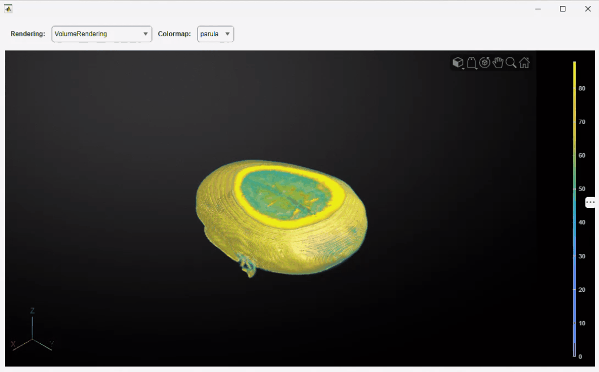

# Volume Show Example: Embeddable Volume Display Component for MATLAB

[](https://matlab.mathworks.com/open/github/v1?repo=MATLAB-Graphics-and-App-Building/volume-show-example)

`VolumeShow` is an embeddable MATLAB&reg; UI component for interactive 3-D volume visualization. Use it when calling [`volshow`](https://www.mathworks.com/help/images/ref/volshow.html) directly is not enough: it adds a colorbar synchronized with the volume and a linked 2-D slice panel, so you do not have to build those pieces yourself.



## About This Example

`VolumeShow` is a custom UI component built in App Designer that wraps [`volshow`](https://www.mathworks.com/help/images/ref/volshow.html) with a synchronized colorbar and a 2-D slice panel for cross-sectional navigation. Use it to interactively rotate, zoom, and pan 3-D volume data while changing rendering styles and colormaps.

When you select the `"SlicePlanes"` rendering style, the component displays three orthogonal slice planes in the 3-D viewer alongside a synchronized 2-D panel. The panel detects which plane you selected and updates the corresponding cross-section in real time as you drag it.

Because `VolumeShow` is a UI component rather than a standalone app, you can embed it in your own UI figure and drive it from ordinary controls such as drop-downs and sliders.

## Setup

### Products

Requires MATLAB&reg; R2026b or newer.

Also requires the following MathWorks products:

- Image Processing Toolbox&trade;

## Getting Started

Open `VolumeShow.mlapp` in App Designer, or create the component directly in the Command Window:

```matlab
load mri.mat
D = squeeze(D);
comp = VolumeShow(VolumeData=D);
```

To inspect or modify the component implementation, open `VolumeShow.mlapp` in App Designer:

```matlab
appdesigner("VolumeShow")
```

## Component Properties

| Property | Description |
|---|---|
| `VolumeData` | 3-D volumetric data, specified as a 3-D numeric array |
| `RenderingStyle` | Volume rendering style, specified as any style supported by `volshow`. The default value is `"VolumeRendering"` |
| `Colormap` | Color mapping, specified as a named colormap string or an N-by-3 array of RGB triplets. The default value is `"parula"` |
| `SlicePlaneValues` | Read-only positions of the slice planes, populated when `RenderingStyle` is `"SlicePlanes"` |

Specify these properties as name-value arguments during construction, or assign them with dot notation afterward.

## Example Files

| File | Description |
|---|---|
| `VolumeShow.mlapp` | The App Designer custom UI component |
| `gifs/volumeActions.gif` | Rotating, zooming, and panning the volume |
| `gifs/slicePlanesUI.gif` | Slice plane navigation with the synchronized 2-D panel |
| `gifs/exploreVolumeUI.gif` | The component embedded in a UI figure with drop-down controls |

## License

The license is available in the [license.txt](license.txt) file in this GitHub&reg; repository.

## Community Support

[MATLAB Central](https://www.mathworks.com/matlabcentral)

Copyright 2026 The MathWorks, Inc.
